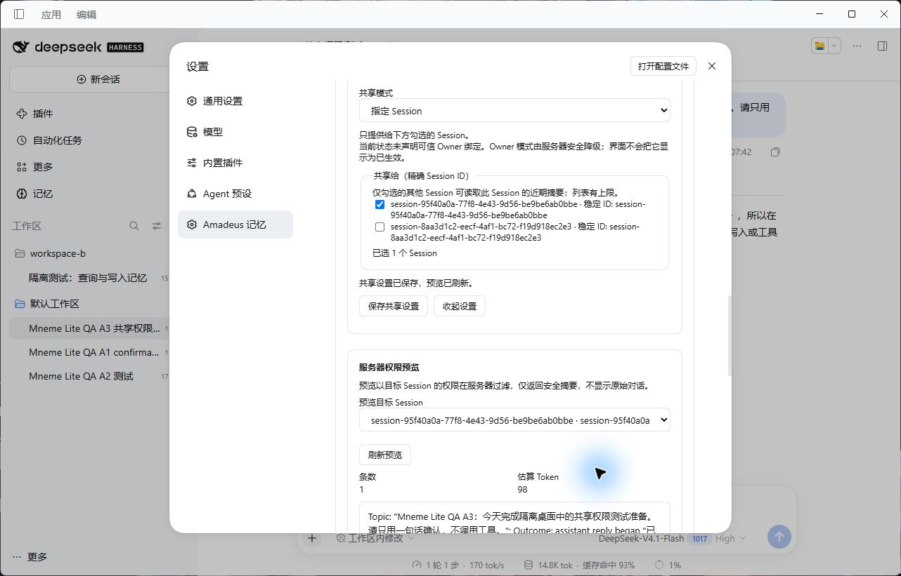

# Amadeus Memory

[English](README.md) · [详细配置参考](REFERENCE.md)

支持方向性会话共享的长期记忆与知识图谱。

目标发行包：**`@fg-lab/amadeus-memory@1.3.0`**。已验证的官方 DSH Desktop 基线：**0.2.1-rc.3**。许可证：MIT。

## 当前发行状态

已发布 **1.3.0**：[GitHub Release](https://github.com/jeskoky-pixel/amadeus-memory/releases/tag/v1.3.0) · [npm](https://www.npmjs.com/package/@fg-lab/amadeus-memory)。请安装固定版本；发行包校验值见 Release。后续源码修改不代表该版本安装包发生变化。

## 能帮你做什么

- Hot Memory 保留近期上下文；按需开启近期动态与 Core Memory，记录跨会话活动和人工精选的重要事实。
- 保存长期事实与经历，通过 BM25、向量或混合检索查找。向量检索需要配置 Embedding 服务。
- 浏览统一知识图谱、实体与别名，调整 Tag/Entity 权重；共享图谱不等于绕过 Session 来源权限。
- 复用 Mneme 自动摘要与 Dream 巩固，并可选启用 Sleep；模型处理可能访问已配置的远端服务。
- 绑定一个 Workspace，在第五页 Amadeus 管理方向性 Learn/Borrow 授权，查看派生知识来源及按 Session 预览图谱。
- Learn 允许合法学习成果在撤销源访问后保留；Borrow 随源访问撤销而失效。学习不代表获得任意转分享权。

示例：让规划会话学习研究会话的项目背景，再撤销源访问。已合法形成的学习成果可保留，未学习的源内容不可继续读取；需要随授权一起失效时选择 Borrow。

Hot Memory 默认开启；近期动态、Core Memory 和 Memory 自带的可选人格卡默认关闭，Sleep 为可选功能。QQ 使用前应核对统一 ACL 工作区及授权。普通 DSH 会话无需安装 QQ；QQ 身份只接受可信 Host 契约。

Amadeus Memory 基于 Mneme，原版记忆、巩固及检索能力不冒称 Amadeus 原创，见[上游署名](UPSTREAM.md)。

## 安装与首次配置

使用官方 DSH 插件管理器将预构建 `.tgz` 安装到所需 Profile，无需手工构建源码。按[安装说明](docs/INSTALL_V1_2.md)操作，不要手工改写正在运行的 Profile。

选择工作区并配置 Session ACL。Learn 保留合法学习成果；Borrow 派生成果随来源访问权撤销。

Memory 已整理为仓库根目录包，不再需要子目录安装后缀。内部插件 ID 仍为 `dsh-mneme`，不要同时加载原版 Mneme。

## 界面

截图展示已有界面，不表示本轮所有真实平台能力均已通过。具体限制请阅读配置参考和验收报告。

## 升级与回滚

升级前备份用户数据。程序、持久数据和恢复备份分开保存。禁用停止功能；卸载默认保留外部数据。回退旧程序不能自动撤销数据库迁移。

- [升级政策](docs/UPGRADE_POLICY.md)
- [数据迁移与恢复](docs/DATA_MIGRATION.md)
- [发行检查清单](docs/RELEASE_CHECKLIST.md)
- [完整配置与限制](REFERENCE.md)

[项目主页](https://github.com/jeskoky-pixel/Amadeus-dsh) · [MIT 许可证](LICENSE)
基于 Mneme，保留原始署名及许可，见 [UPSTREAM.md](UPSTREAM.md)。

### 模型工具（默认注册 13 个；全数 16 个）

| 工具 | 功能 |
| --- | --- |
| `memory_save` | 写入记忆 |
| `memory_search` | 检索记忆 |
| `memory_list` | 列出记忆 |
| `memory_get` | 读取记忆正文 |
| `memory_preference_get` | 查看偏好权重 |
| `memory_identity_lookup` | 查询身份与别名 |
| `memory_update` | 更新记忆 |
| `memory_delete` | 删除记忆 |
| `memory_forget` | 抑制记忆注入 |
| `memory_archive` | 归档与恢复 |
| `memory_core_save` | 核心记忆写入；需开启 `coreMemoryEnabled` |
| `set_scope_state` | 设置可逆作用域闸门 |
| `memory_register_document` | 登记文档指针 |
| `memory_organize` | 主动整理；需开启 `organizeEnabled` |
| `memory_runtime` | 查看本地运行时 |
| `memory_recent_activity` | 查询近期活动；需开启 `recentActivityEnabled` |

## 隐私承诺

`autoDream` 与 `autoSummarize` 的巩固和摘要走宿主模型；默认 Embedding 配置也可能访问远端服务。只有显式选择本地 Embedding 并安装本地运行时，语义向量才在本机计算。插件不向 Amadeus 自有服务器传送记忆正文。

## Privacy

`autoDream` and `autoSummarize` use the host model for consolidation and summaries. The configured embedding provider may be remote. Semantic vectors stay local only when local embedding is explicitly selected and its runtime is installed. The plugin does not send memory bodies to an Amadeus-owned server.

软件包不携带用户数据库、QQ Token 或模型密钥。用户数据位于插件安装目录之外；卸载代码不等于删除数据。旧版代码未必能读取已迁移的数据库，回滚时须配套恢复升级前备份。详情见 [中文指南](docs/USER_GUIDE.zh.md)、[备份与回滚](docs/BACKUP_ROLLBACK.md)。
