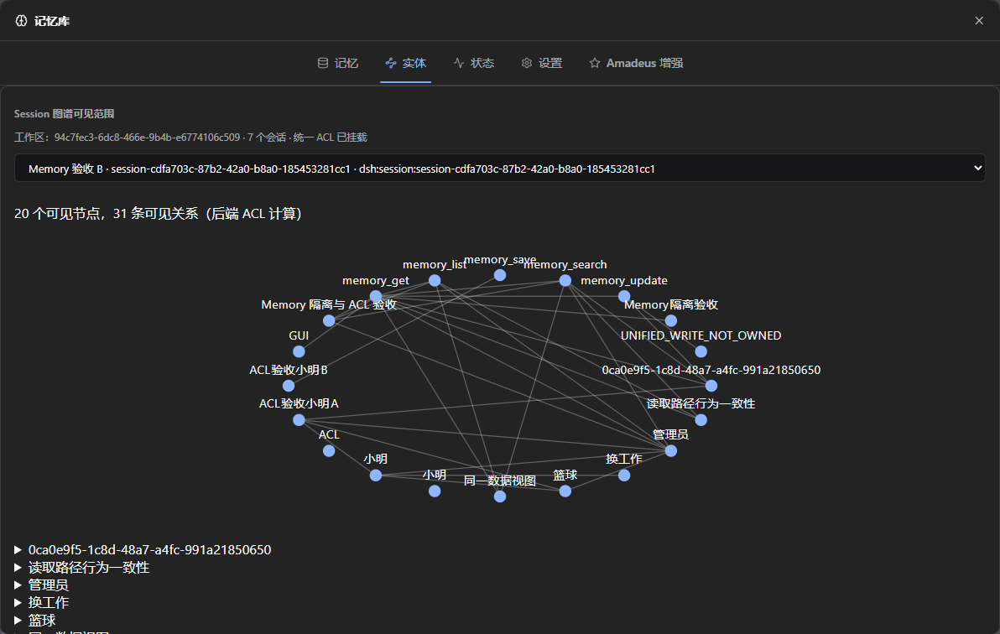
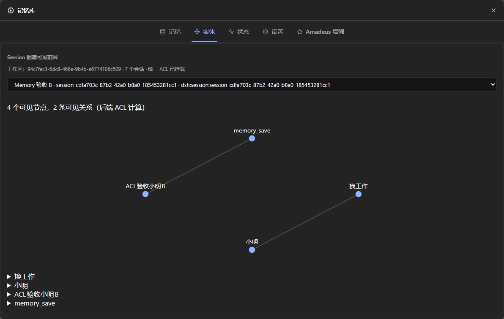

# 主 DSH Desktop 实机验收：2026-10-30 至 2026-10-31

结论：**B，可继续受控试用；不是正式发行验收通过。** Memory #7、QQ #6 保持 Draft，不合并、不发布。

## 实际版本与安装

- 官方 Desktop 实际运行版本：0.2.1-rc.3；更新提示不计作已安装版本。
- 替换前、后 Memory/QQ 包版本均标作 1.2.0，因此以提交和包哈希识别候选。
- Memory 修复源码：`62e3ec5911ff4c15edecb7abc449c8b85d630619`，基于 `dccf38638d5eb7b47e02a8cf1ceda74af8b40ec3`。
- QQ：`8c79b4d7cfd33a1ca3b327b0743912df9b8526ee`，完整候选已安装；本轮没有更改 QQ 源码。
- Memory 安装产物：`memory-real-fix6.tgz`，SHA-256 `14349fa87d0950bbc5f0cc6dfccfac96d639ae14633d2ee97fd8fe66e1bca77f`。
- 包名 `@fg-lab/amadeus-memory@1.2.0`，内部插件 ID 仍是 `dsh-mneme`。
- 保留冻结旧基线 `d1c1aa405ad12092ac125ee00798476a5069d07b` 及其安装包。
- 使用用户主 Profile 和既有 Amadeus Workspace。Life、State、Persona 的安装和配置未作产品修改。
- 安装前备份了 Profile、Memory 整个数据目录、QQ 数据和已安装包；未删除旧 Memory 库、其他工作区或 QQ 登录数据。

## 修复内容

1. 近期动态跨 QQ/普通 DSH 的配对门禁改为验证双方可信身份；是否共享仍由独立的单向近期动态策略决定，不能由长期 ACL 代替。
2. 原版新增记忆对话框要求显式选择真实来源 Session 或管理员专用保存。旧无来源入口在统一 ACL 下明确拒绝。
3. 修复统一 ACL 与旧 strict Scene 门禁叠加导致自己的 memory_get、memory_update 失败；共享读者仍不能改写来源记忆。
4. Owner 原版 GUI 编辑采用内部授权符号；伪造 actor/source 字符串不能获取权限。
5. 管理员图谱使用规范实体分组；Session 图谱继续按事实来源过滤。
6. 实机发现自动摘要可将授权期间读到的 A 内容重写成 B 自有记忆。增加持久化 shared-history 派生保护；共享历史 Session 暂停自动摘要和近期动态再派生。近期动态的实际模型共享读取同样记录此保护，Owner 预览不算模型读取。重启或撤权不会清除保护。

第 6 项是保守的安全限制，并非完整的跨来源派生依赖追踪。没有共享历史的 Session 仍可自动摘要，Dream/Sleep 只处理各自来源。显式模型写入或用户主动复制的既有内容不能靠撤权自动抹除；宿主旧聊天历史也不会被清空。

对本次已经生成的 3 条合成错误派生记忆，先另存数据库快照，再补入 A 的必要来源关联；原记录保留，撤权后不可由 B 单独读取。清除了 B 的受污染合成近期摘要。这是本轮已知测试数据修复，不是对任意旧库的自动迁移保证。曾使用旧候选进行共享的数据库需要审查派生记录，不应无条件标记安全。

## 实际验收证据

| 项目 | 结果与边界 |
| --- | --- |
| 普通 A/B、custom Preset C | 实际 Host Session + OpenCode Go DeepSeek 模型保存、搜索、列表、按 ID 读取 |
| 默认隔离 | 各自记忆可读；未授权来源不可读 |
| GUI A → B | 单向只读授权；真实模型可读 A，改写 A 返回 UNIFIED_WRITE_NOT_OWNED |
| GUI 撤销与取消 | 取消未保存修改恢复原选择；保存撤权后 B 图谱收缩 |
| 新模型回合撤权 | 搜索与按 ID 读取拒绝 A；修复后的新 runtime-context 不含 A 的测试事实 |
| 重启持久性 | 多次正常插件重载/主 Desktop 重启，来源、保存数据、撤权和派生保护保留 |
| 近期动态 | 真实 Host A→B、QQ→DSH、DSH→QQ、群→Owner 私聊的授权/撤权；真实模型 QQ→C 读取及撤权成功 |
| NapCat | 用户真实群/私聊入站；私聊自动回复、群内受控模型回复；get_msg 回读群回复成功，登录账号未变 |
| 群聊自动接话 | 原始非定向群消息未自动唤醒，后由受控真实 Session prompt 验证读入及投递；不能称该群自动接话已通过 |
| QQ 记忆 | 真实模型读取本群记忆；autoSummarize 实际写入可信 QQ 来源 |
| QQ 直接模型保存 | 当前 safe-chat Preset 未暴露 memory_save，未绕过权限，不能标记直接保存已通过 |
| 自动后台任务 | 真实 autoSummarize、实体抽取、Dream、Sleep 成功；跨来源作业隔离另有回归测试 |
| GUI 五页 | 原四页与第五页可打开；实际新增来源选择、编辑、图谱选择、授权/撤权、取消、备份按钮验证 |
| 备份恢复 | GUI 创建真实 SQLite 快照；在独立副本执行官方 stage/apply 恢复，33 条来源关联保留，quick_check=ok；未对主库执行破坏性恢复 |
| 其他插件 | Life/State/Persona/QQ 的鉴权状态接口均 200；本轮未重复做它们的全功能实机验收 |

授权与撤权截图：

管理员图谱可合并为规范实体。Session 视图不公开没有 Session 级证据的全局合并关系，因此同名节点可能仍分开；这与属性/关系按记忆证据撤销是两件事，不以自动同名合并掩盖限制。

## Embedding、检索和性能

当前主 Profile 未配置可用云 Embedding/Rerank，也未找到应当复用的 SiliconFlow 配置；本轮未宣称复用不存在的配置。

内置运行时联网安装请求超时，随后通过插件支持的本机依赖收编完成运行时；模型原站下载失败、配置镜像后成功。实际新增本地 CPU `Xenova/bge-small-zh-v1.5`，512 维、CLS/q8。主 DSH 的 semantic 状态 ready=true，首次检查 21/21 条已嵌入，最终正常重启检查 25/25 条已嵌入。云密钥未写入包或仓库。

实际模型分别在 B、C 以两个同义表达执行 keyword/vector/hybrid：keyword 均未命中；vector/hybrid 均命中自身相关条目，未返回已撤权的 A 私密测试事实。六次实测工具耗时为 keyword 13/14ms、vector 16/19ms、hybrid 15/17ms。样本只有每模式 2 次，不能据此宣称可靠的 P95 或旧版性能提升。

普通 HTTP 搜索在严格场景门禁下返回空候选，这不是模型检索性能基准。未配置 Rerank；未测大型库、GPU、并发压力。没有同条件旧版实机测量，无法量化统一 ACL 相对旧版的净开销。

## 真实模型用量与参考费用

Provider：OpenCode Go；模型标识：deepseek-v4.1-flash。用户使用订阅计划，下列仅按官方等价模型定价估算，不能当成实际账单。

- 对话模型调用：42 次；非缓存输入 123036，缓存读取 793728，输出 6658 tokens。
- 后台模型调用：43 次；日志输入 22892，输出 38665 tokens。后台审计未提供缓存分拆。
- 参考官方 DeepSeek-V4.1-Flash-1017 非高峰价格：每百万输入 $0.15、缓存读取 $0.003、输出 $0.60。
- 合计参考 **$0.05146 USD**。后台输入按非缓存估算；不包含未能启动的委派进程，没有将失败启动计为成功请求。
- 官方来源：https://api-docs.deepseek.com/quick_start/pricing
- 后台调用分类和耗时见 [usage-cost.json](main-20261030/usage-cost.json)。输入量并不等于全部按未缓存计价。

## 回归与尚未覆盖项

最终质量门禁：**765 passed，0 failed，0 skipped**。覆盖新增授权门禁、显式归属、严格模式自身读写、共享不可写、规范图谱、派生保护的重启持久性，以及真实近期读取/Owner 预览的区别。QQ 源码未变，没有为同一提交反复跑全套测试。

以下仍未完成本轮逐项实机验收，不能用自动化通过代替：第二个真实 QQ 群、删除后重建 QQ Session、Owner Agent 直接 memory_save、NapCat Desktop 自身退出重启后的网络配置保留、浅色主题及全部别名/权重/核心/归档操作、完整 Life 自主外发及 Persona 工具集比较。TTL/Token 上限和多群组合主要由自动化验证。

已验证无需验收驱动：通过真实 Desktop 左侧打开 B 后，可信来源及原 Session ID 恢复。当前宿主按需加载 Session，未加载的会话可能暂时在权限页显示未验证，需要先打开会话；这仍是管理体验限制。

历史普通 Session 如不能由 Host 证明来源，仍拒绝访问；本轮创建的测试 Session 已可信登记。不得以标题或 QQ Preset 名称放宽这个边界。

## 保留和回滚

主 Profile 保留本候选供小规模试用，测试用临时入口已移除（返回 404），调试端口已关闭，主 Desktop 已以正常模式重新启动。保留用户 NapCat 登录；只启用已有 QQ 配置所需的 loopback HTTP/WS 接口，变更前有备份。未修改账号资料或空间，未向未授权目标发送。

后台测试阈值已恢复为 Dream 10 条、2000ms 延迟、60 分钟最小间隔、Sleep 空闲 5 分钟；摘要每 Session 最多 1 次仍为本轮保守试用配置。

回滚必须先完全停止 Desktop，保留当前数据快照，再恢复同一时点的 Profile 配置/锁文件、原安装包、Memory 和必要 QQ 数据，随后重启检查。不能只换旧代码却保留不兼容的新库；不要覆盖其他插件或 NapCat 登录数据。完整本机备份位置和恢复说明保存在私有验收目录，不上传配置、私聊、认证 URL 或原始模型上下文。

本次不承诺“全部实机验收完成”，也不批准正式发行。共享历史的自动派生限制需要用户在受控试用时知晓。
