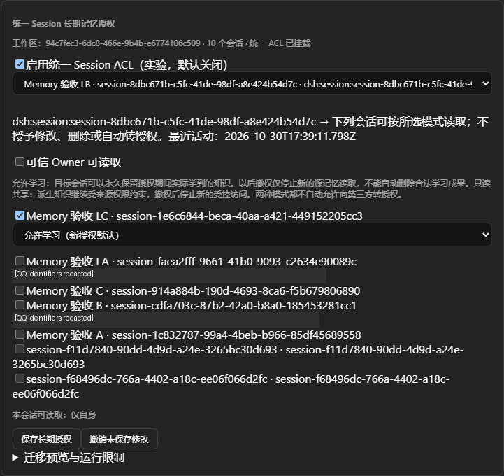

# Unified Session ACL Learn/Borrow — 2026-10-31

Status: development candidate, PR #7 remains **Draft**. No merge, npm publication or market release.

## Change and migration

Base: `3d4b139a2c0ebb1cc913a4f9865697baa74d768f`. New explicit grants default Learn. Existing schema-1 grants remain legacy Borrow, and unchanged saves preserve permit IDs. Owner read and Recent Activity permission remain independent.

Actual context/tool delivery mints Host-owned evidence; derived records retain source version hashes, acquisition permits and ancestry. Learn permits survive revoke and delayed summarization. Borrow dependencies remain live authorization checks. Third-party access requires both owning-source access and sufficient original-source access. Metadata-only maintenance does not add unrelated ancestry.

Session-wide permanent freezing is replaced with receipt-aware processing and a conservative original-user-message fallback for unknown history or expired Borrow. Full mixed assistant/tool history is never silently relabelled as independent. The GUI explains permanence, revocation and legacy upgrades; the original four pages and fifth Amadeus page remain.

Schema 2 creates a consistent pre-migration SQLite image before additive transactional migration. Two existing main-profile shared-history markers were retained as `unknown-history-quarantined`; no historical Learn rights were inferred. Main pre-upgrade backup reads successfully as schema 1 (`quick_check=ok`, 30 memories). Synthetic migration tests verify original data, legacy Borrow, idempotence and old-schema snapshot restoration.

## Automated validation

`npm run quality:amadeus`: **781 passed, 0 failed, 0 skipped** (31.97 s in the final full run).

High-value coverage includes default isolation; new Learn; unused grants; actual receipt recording; delayed Learn/Borrow writes across revocation; transaction rollback; forged evidence; changed source versions; mixed roots; second/third-generation restrictions; native metadata updates; clean input after expired Borrow despite unrelated new delivery; GUI policy delta updates/conflicts; legacy migration; real original Dream/Sleep algorithms repeatedly preserving ancestry; trusted Session ID routing in background requests; and an inherited Recent Activity regression proving the publisher still needs its own independent Learn grant.

The first full run found obsolete freeze assertions and source/build drift caused by concurrent development. Both were corrected; these failures are not omitted from private logs. A final failing regression exposed a missing publisher root on inherited Recent Activity; the fix preserves both inherited roots and the publisher’s separate Borrow/Learn permission. Final source/lib consistency and source privacy checks pass.

## Actual main Desktop checks

Host: official DSH Desktop **0.2.1-rc.3**, existing Workspace and current OpenCode Go DeepSeek provider. Existing Profile, Memory, SQLite/WAL, QQ source records and installation packages were backed up first. Three fresh synthetic test Sessions were added because two earlier Sessions had unverifiable historical shared content.

- Actual Desktop GUI: check target → Learn selected by default; switch Borrow; cancel; save; mode and revocation persisted after restart.
- Actual model: source memory read, learned memory_save, and autoSummarize generated provenance-bearing records. Revoke denied source memory_get while learned memory_get remained readable.
- A separate third Session could not read the learned result merely through the learner's grant.
- Actual Borrow: source read and derived save during grant; after revoke both direct and derived memory_get were denied.
- After Borrow revocation, a fresh original human fact was automatically summarized into three independent records with zero external roots.
- Actual QQ Host: group → ordinary Session and ordinary → trusted Owner private Session grants defaulted Learn and model tools read the synthetic source facts successfully. The second physical QQ group was unavailable; two-group isolation remains automated coverage, not a claimed second real-group test.
- Existing local CPU embedding remained ready, 512 dimensions, 43/43 coverage at the measured checkpoint. Model vector/hybrid requests returned the learned facts. The public owner HTTP search endpoint intentionally uses public-only visibility and returned keyword fallback/no private rows, so its timings are **not** used as proof of vector retrieval.
- Real background testing exposed OpenCode Go `MissingSessionID` errors. The candidate now forwards the verified source Session ID through the existing GenerateOptions contract. Successful real Dream consolidation/summary and Sleep pattern derivations followed; generated learning summaries/patterns retained original ancestry.

No new QQ external send was needed for this Memory iteration. Existing authorized QQ Sessions and the trusted QQ Host contract were exercised; this does not claim a fresh end-to-end NapCat ingress/egress test or two real groups. Life, State, Persona and QQ implementation were not changed.

## Performance and request accounting

Fixed synthetic benchmark, identical 500 native records, same directional grant, 10 warm-ups + 100 measured keyword queries, limit 10:

| Candidate | P50 | P95 | SQL preparations/query |
|---|---:|---:|---:|
| Baseline PR head | 0.605 ms | 0.656 ms | 6 |
| Learn/Borrow | 0.674 ms | 0.738 ms | 8 |

This is a small in-memory security-path benchmark, not a production workload estimate. P95 increased about 0.082 ms (~12.5%). Derived-root fanout and long historical receipt sets can cost more. No extra model source-classification call is introduced. Existing autoSummarize, extraction, Dream and Sleep calls remain real costs and are recorded separately in local audit evidence. OpenCode subscription usage is not represented as pay-as-you-go billing.

## Actual model/background checkpoint

At the final principal-check checkpoint: 29 agent requests, 104,877 input tokens, 3,589 output tokens and 643,840 reported cache-read tokens. Cache accounting is provider-defined; these numbers are not an invoice. Background audit: autoSummarize 10 successful / 0 failed calls (4 earlier budget skips); Dream 8 successful consolidation calls and 7 successful summary calls after the Session-ID correction; Sleep 8 successful pattern calls. The earlier 5 Dream and 2 extraction `MissingSessionID` errors remain in the audit, not reclassified as successes. Aggregate successful/failed wall durations were approximately 91.1 s for summarization, 90.1 s for consolidation, 47.0 s for Dream summaries and 99.7 s for Sleep patterns; these sum independent requests, not a single-turn latency.

At that checkpoint the acquisition ledger contained 10 receipts / 4,322 bytes of root JSON (excluding SQLite/index overhead). Actual model checks verified that native B facts remain shareable while B's Dream and Sleep derivatives stay unavailable to unauthorized C. Recent Activity delivered a Borrow receipt without a long-term grant. Final test grants were removed and the source's recent policy restored to self.

The prior test-only one-summary-per-Session budget was restored to the normal unlimited setting (`summarizeMaxRunsPerSession=0`). Temporary accelerated Dream/Sleep timings are restored during cleanup. The acceptance driver and browser debug port are removed before normal main Desktop restart.

## Real GUI evidence

The image is a real Desktop screenshot cropped to the ACL card. Only the real QQ identity labels were masked; the controls and values are unchanged.

## Evidence and limits

Raw tool events, model usage, authenticated URLs, config and databases remain private. Local evidence includes actual GUI screenshots, model revoke checks, root audit, migration snapshot checks, HTTP/model health and retrieval benchmark JSON. Screenshots containing real Profile/QQ labels are not uploaded unredacted.

Conservative mixed-source processing can over-restrict content; it does not invent a source classifier or trust model claims to loosen access. Model saves that still use inseparable expired Borrow history can be rejected even though fresh-user automatic summaries continue. A clean Session is the supported route to fully clean assistant history.

Software controls structured Memory access. It cannot erase already delivered context or guarantee that a model/user never repeats information in natural language. Background-job wall time is model/network dependent and is not compared as a controlled before/after latency experiment. Cloud embedding and reranker were not configured and are not claimed as verified.

Rollback: stop DSH, preserve the new data separately, restore the old package + matching configuration + pre-schema-2 consistent DB snapshot, without mixing current WAL files. The old snapshot restore was checked separately; the live main Profile was not downgraded as part of this test.

See [user semantics and migration](../SESSION_LEARNING.md).
