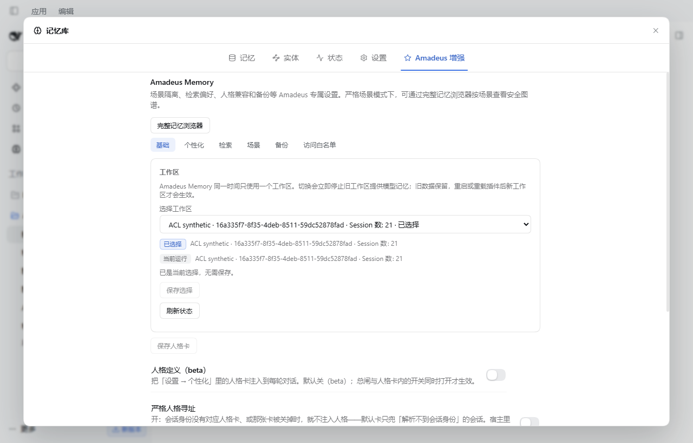
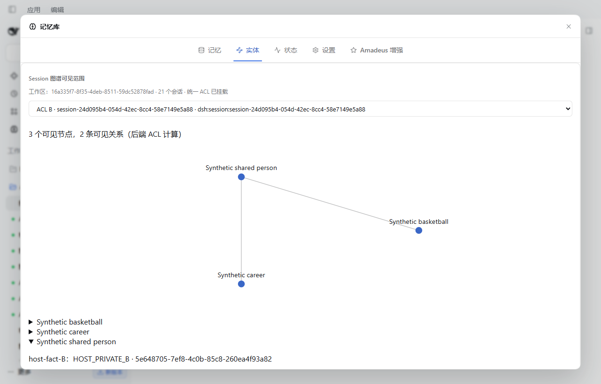
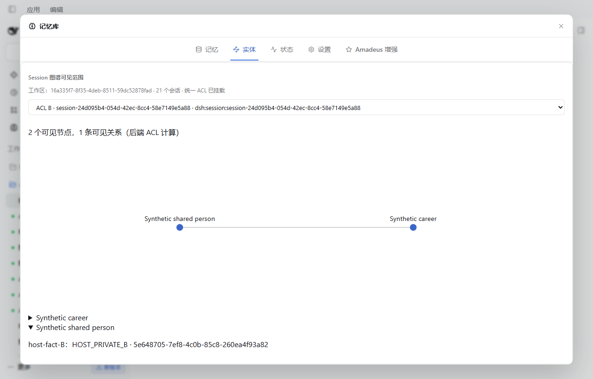

# Unified Session ACL — final isolated candidate verification

Date: 2026-10-30. Status: development candidate, **Draft PR #7**, not production
approval. This supersedes the runtime limitations at the earlier
[experiment checkpoint](UNIFIED_SESSION_ACL_EXPERIMENT.md), which is retained as history.

## Implementation and dependency

One selected official DSH Workspace owns one database and global entity graph.
The default-off `unifiedSessionAclEnabled` flag mounts a trusted runtime around
model tools, injection, summarization and background work. The original Mneme
scope/archive/forget filters remain additional restrictions. A directional
grant expands reads only; it is neither transitive nor permission to mutate
another source. Owner reads require the source's explicit Owner policy.
Recent-activity policy remains separate, with independent trusted pair checks.

QQ requires the **paired candidate** `codex/qq-session-provenance-v1`, stacked on
QQ's existing `codex/v1.2-release` branch. Package version 1.2.0 alone does not
identify this contract. Use the exact commit pair recorded in the PRs.
No released package or production connector was changed.

The installed official Desktop 0.2.1-rc.3 SessionController supports fresh
preallocated IDs but does not provide a complete historical creator ledger.
QQ therefore durably reserves an ID before calling Host create, checks the
returned ID and retains failed/retired reservations. Ordinary classification
requires a real live Host header created during an observed interval; confirmed
ID/creation-time pairs persist. Unknown historic gaps fail closed. Titles and
custom Preset names never establish identity. Resume uses Host resolveAgent,
not create. A Host that ignores reserved IDs stops new ordinary classification.

Memory retains verified ordinary attestations when QQ is removed, while new
unknown Sessions remain blocked after a QQ dependency has been observed.
An unconfigured disabled QQ explicitly declares creation disabled, allowing
new ordinary Host Sessions without guessing historical provenance.

Graph attributes and relations use memory evidence independently of their global
entity UUID. SQL filtering and current-result rechecks prevent sharing through
hidden relations, alias metadata or asynchronous reranking. Global entity
identity/merge management is administrator-only in unified model contexts.
Source jobs use live trusted anchors and self-only rights, never a reader's
sharing grants. Original Dream/Sleep algorithms are retained inside that boundary.

## Test evidence

| Gate | Result |
| --- | --- |
| Memory full quality (`node scripts/quality.mjs`) | 761 passed, 0 failed, 0 skipped |
| QQ complete local tests | 303 passed, 0 failed, 4 skipped |
| Latest client syntax and package installation | Passed |
| Official Desktop 0.2.1-rc.3 actual UI clicks | Passed |
| Official Workspace/Session → model adapter → tools/injection | Passed with deterministic loopback model |
| Actual Host turn/end → autoSummarize → two QQ sources | Passed with deterministic loopback model |
| Frozen package + database restore + Host restart + model read | Passed |

The four QQ skips require Windows symlink support unavailable to these tests.
They are not hidden NapCat acceptance passes. Tests include pending creation,
failed reservations, mismatched IDs, historical gaps, restart, deletion,
renaming, disabled transport, unknown identity, ordinary/QQ recent pair rules,
read-only sharing, grant conflicts, source jobs, workspace disposal during
summarization, owner endpoint authorization and the existing 28 ACL cases.
Full quality ran after runtime changes; the final GUI-only Workspace label
addition was syntax-checked, packed, installed and clicked rather than rerunning
an unchanged full backend suite.

### Real isolated Desktop scenario

The isolated profile used real official Workspace, Session, connection auth,
plugin installation and Electron GUI services. A/B use the same ordinary
Preset; C/D use two custom Presets. Q1/Q2/O use the actual packaged `amadeus-qq`
Preset and real QQCore bindings, with a synthetic transport. X is in another
Workspace. All data and IDs are synthetic; no production profile or keys copied.

- A/B/C/D save and read their own data through the actual model/tool chain.
- Q1/Q2/O read their own Scene data. The safe-chat QQ Preset's existing write
  restrictions are preserved; O has a trusted Owner identity but this test does
  **not** exercise the separate Owner-Agent Preset.
- GUI A → B grant makes A visible in B's tool result and new memory injection;
  other Sessions remain isolated. B update/archive/delete of A is rejected.
- GUI unsaved revert, saved revoke and backend graph projection all work.
  B's shared entity changes from A+B attributes to B-only after revocation.
  Revocation does not erase facts already present in past chat/model history.
- Out-of-Workspace X is rejected. Persistence was verified after actual restart.
- Two QQ turn/end events produce the same synthetic summary title with distinct
  trusted Scene stamps, rather than one legacy or cross-source merged memory.
- Recent ordinary C/D sharing and its independence from long-term policy are
  tested through the real recent-activity implementation in integration tests.
  Dream/Sleep isolation and async disposal are algorithm integration tests;
  a real Desktop idle schedule was not timed.

The original four pages remain. Fifth-page General displays Workspace name,
stable ID, count and active state; Access whitelist displays real Sessions,
stable source, verification, activity and directional grant controls. Long-term
policy changes use revision checks. Entities keeps the original admin graph and
adds backend-authorized Session previews (bounded to 200 nodes, visibly marked
when truncated). Screenshot evidence:

## Performance and cost

Reproducible command: `node scripts/benchmark-unified-acl.mjs BASELINE_PACKAGE_DIR OUTPUT.json`.
Frozen baseline is `d1c1aa405ad12092ac125ee00798476a5069d07b`.
Node 22.23.2, 5 sources, 64-dimensional precomputed synthetic vectors, 3 warmups
and 25 measured samples per operation. No network embeddings or cloud model.
Raw metrics include SQL calls, synthetic Host checks and result cardinalities:
[performance.json](unified-acl-final/performance.json).

Milliseconds P50 / P95, baseline → candidate:

| Operation | 1,000 memories | 10,000 memories |
| --- | --- | --- |
| List | .671/1.127 → .453/.652 | 4.403/5.618 → 2.898/4.426 |
| BM25 | 3.046/4.034 → 3.446/5.554 | 9.518/10.625 → 11.310/16.438 |
| Vector | 3.836/5.436 → 5.401/8.667 | 11.836/16.080 → 15.538/20.512 |
| Hybrid | 4.382/6.367 → 5.331/8.363 | 10.409/13.716 → 15.975/31.330 |
| Direct graph | .046/.127 → .120/.251 | .051/.115 → .099/.181 |
| Two-hop graph | .146/.398 → .178/.323 | .138/.413 → .204/.391 |
| Injection candidate retrieval | 2.466/3.608 → 2.688/8.071 | 6.039/8.784 → 5.617/8.132 |
| Dream | 3.922/5.501 → 4.417/5.728 | 27.070/30.684 → 28.616/32.311 |
| Sleep | 18.577/22.524 → 42.461/48.408 | 33.647/42.832 → 60.738/71.848 |

Permission batching reduced the investigated injection path from 854 to 58 SQL
calls and 427 to 29 Host checks. There is no cross-call authorization cache;
post-await checks remain. Graph output is intentionally smaller (baseline 2/3
direct/two-hop results versus candidate 1/1), so graph timings are **not** a
same-result performance improvement claim. Injection numbers measure candidate
selection, not end-to-end cloud model latency. The actual model-loop test is
functional evidence, not a latency benchmark.

Sleep and hybrid retrieval regress materially in relative terms. On these
synthetic workloads their P95 remains below 72ms/32ms respectively, acceptable
for isolated evaluation, not a production latency guarantee. Larger real graphs,
real embeddings, actual provider tokens and KV-cache costs remain unmeasured.
The per-source background benchmark used 84 mock LLM calls for each version;
source-safe production scheduling may require more calls than unsafe global
batching. No claim of zero token overhead is made.

## Migration and actual rollback

Schema changes are additive/idempotent (`unified_acl_meta`, bindings, policies
and grants); original memory/graph tables and internal `dsh-mneme` ID remain.
Legacy rows are kept in administrator quarantine, not silently assigned a source.
Back up while stopped, including database/WAL state, configuration and QQ state
plus provenance sidecar. Never infer trust by editing the database.

The separate rollback profile installed the frozen package through the official
installer, selected a Workspace, wrote OLD through the actual model tool,
stopped, copied a consistent full memory snapshot, installed this candidate,
enabled ACL and wrote NEW from a newly trusted Session. OLD remained intact.
The candidate was then stopped, its data retained separately, frozen package
and original database/configuration restored, Host restarted, and OLD read again
through the model tool. Exact original rows matched; NEW was absent as expected.
[Rollback evidence](unified-acl-final/rollback.json).

Frozen branch `backup/amadeus-memory-pre-unified-session-acl` is unchanged.
Frozen package SHA-256:
`2FD41422A6FA30B60975FF8B306BCFECB80F39DA3CACDAB84FF72B0ADC3AC392`.
Reinstalling old code alone is not a sufficient database rollback procedure.

## Explicit limits and safe degradation

- Historical unverifiable Sessions need matching provenance recovery or a new
  Session. An unloaded Session must be opened to obtain a live trusted anchor.
- Source background jobs skip sources lacking live trusted Sessions. Continuity
  file rescue and automatic workflow nudges are disabled in unified mode, with
  GUI disclosure. Global model metadata management is intentionally restricted.
- Scoped model writes defer full Markdown mirroring to administrator sync or
  restart recovery, avoiding a partial source view overwriting the global mirror.
- No real NapCat account, public QQ delivery, cloud LLM/embedding, or production
  database participated. These require separately authorized external acceptance;
  the current task explicitly permits the synthetic transport/model substitute.
- Permission changes cannot retract previously delivered chat context. The gate
  guarantees new reads/injections, not retroactive erasure.

All executable isolated gates above passed. The paired Draft candidates can be
reviewed for opt-in isolated use; they are not a recommendation to enable this
architecture on a daily profile without backup and external workload validation.
No main merge, release, npm or Market publication is part of this delivery.
